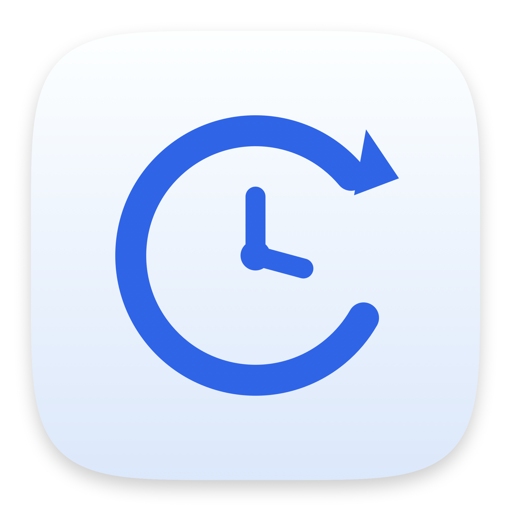

<p align="center">
  
</p>

<h1 align="center">Backup Control</h1>

<p align="center">
  A small, native macOS app that puts a friendly face on
  <a href="https://restic.net">restic</a> + <a href="https://rclone.org">rclone</a>
  encrypted, incremental backups to OneDrive.
</p>

<p align="center">
  
  
  
</p>

---

## What it does

- **One-click backup** to OneDrive — encrypted on your Mac before upload
- **Incremental & deduplicated** — only new or changed chunks are uploaded
- **Choose what to back up** — Documents, Desktop, Pictures, Music, Downloads, dotfiles, or your whole home folder
- **Live estimates** — size, file count, measured upload speed and ETA before every run
- **Data caps** — monthly upload budget, bandwidth limit, AC-power only
- **Scheduled** — daily at a time you pick (launchd), low priority I/O
- **Restore-friendly** — snapshots are content-addressed; deleted files stay recoverable
- **English / 简体中文** UI, light & dark mode
- No account, no telemetry, no analytics

## Requirements

| | |
|---|---|
| macOS | 14 Sonoma or newer |
| Tools | [`restic`](https://restic.net) and [`rclone`](https://rclone.org) (`brew install restic rclone`) |
| Remote | An rclone remote with `rclone config` (examples assume the name `onedrive`) |
| Build | Xcode Command Line Tools (`xcode-select --install`) |

## Setup

```bash
# 1. Install the two engines
brew install restic rclone

# 2. Create an rclone remote (OAuth in your browser)
rclone config          # n → onedrive → Microsoft OneDrive → follow prompts

# 3. Build the app
git clone https://github.com/<you>/backup-control.git
cd backup-control
./build.sh

# 4. Run it (first launch asks for Full Disk Access if you back up protected folders)
open "build/Backup Control.app"
```

On first launch the app copies its helper scripts to
`~/Library/Application Support/macbackup/` and creates `config.json`.

### Configure remote name / path

`config.json`:

```json
{
  "remote": "onedrive",
  "repoPath": "MacBackup/restic",
  "autoEnabled": false,
  "hour": 3,
  "minute": 0,
  "monthlyCapGB": 25,
  "bwlimitMB": 2,
  "language": "en",
  "useProxy": false,
  "scope": ["documents", "desktop", "pictures", "dotfiles"]
}
```

`remote` must match an rclone remote name. `repoPath` is the folder inside it.

## Restoring

Always restore to a scratch folder first:

```bash
export RESTIC_PASSWORD_FILE="$HOME/Library/Application Support/macbackup/restic.pass"
export RESTIC_REPOSITORY="rclone:onedrive:MacBackup/restic"

restic snapshots
restic restore latest --target ~/Desktop/Restore
restic restore <snapshot-id> --target /tmp/one --include "/Users/you/Documents/report.docx"
```

> **Keep the repository password safe.** Without it the data is unrecoverable —
> restic cannot reset it. A copy in your password manager is strongly advised.

## How it compares to Time Machine

| | Backup Control | Time Machine |
|---|---|---|
| Scope | user data you select | whole system |
| Destination | any rclone remote | local disk / supported NAS |
| Encryption at rest | always (client-side) | depends on target |
| Full-system recovery | no | yes |

They solve different problems — use both if you can.

## Legal & disclaimers

- **Not affiliated** with Microsoft, OneDrive, Apple, restic or rclone. Names are
  used descriptively only; no logos are included.
- **Encryption**: the app invokes restic, which encrypts with AES-256 + Poly1305.
  No cryptographic code is implemented here.
- **No warranty.** This is backup software: test your restores. Provided under
  the MIT license, without warranty of any kind.
- **Your data, your keys.** Credentials live in
  `~/.config/rclone/rclone.conf` and the restic password file; the app never
  transmits them anywhere except to the configured remote via rclone.
- The app icon and glyphs in this repository are original vector artwork.

## License

MIT — see [LICENSE](LICENSE).

---

<p align="center"><sub>Built with SwiftUI. Ships no binaries, no telemetry, no accounts.</sub></p>
