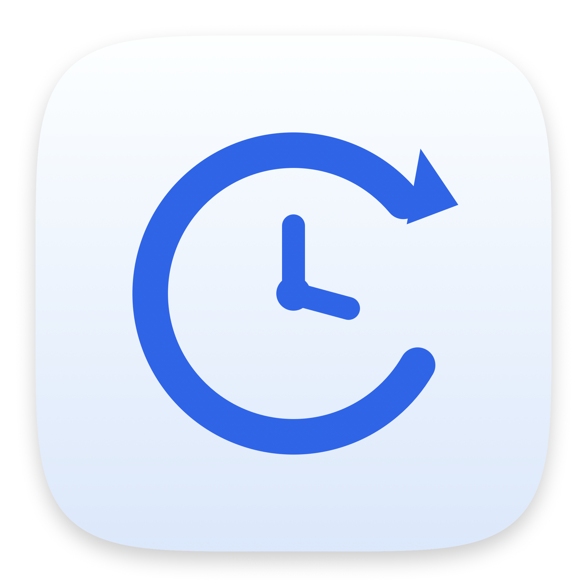
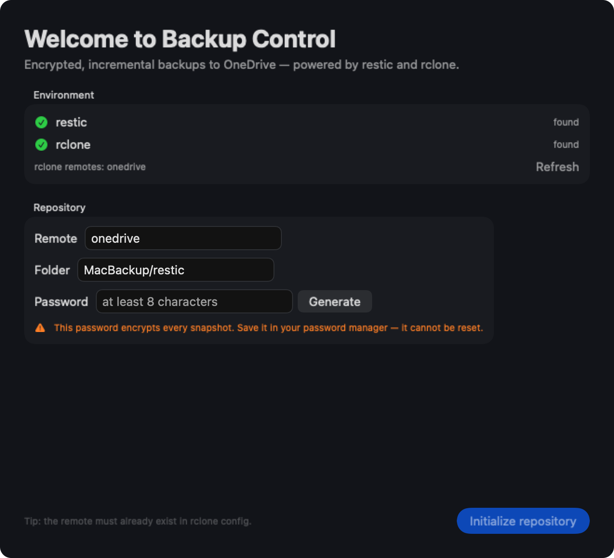
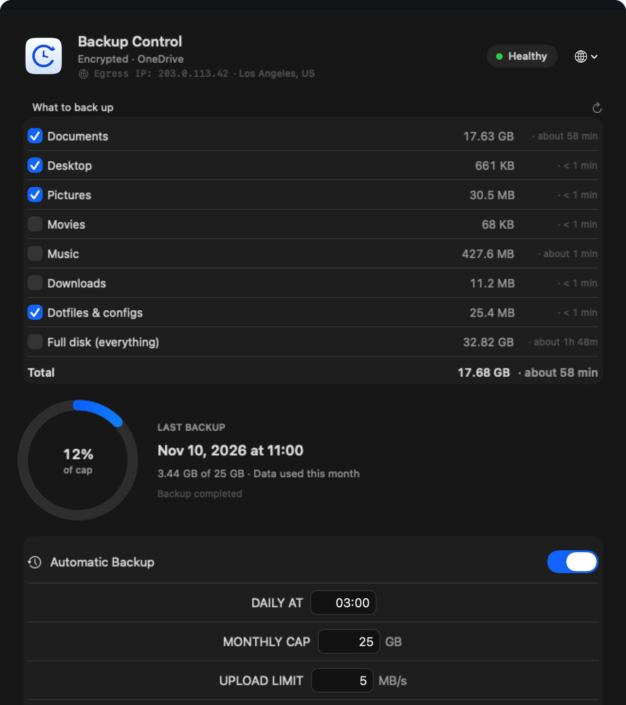

<p align="center">
  
</p>

<h1 align="center">Backup Control</h1>

<p align="center">
  一个原生 macOS 小应用,把 <a href="https://restic.net">restic</a> +
  <a href="https://rclone.org">rclone</a> 的加密增量备份变得简单好用 —— 备份到 OneDrive。
</p>

<p align="center">
  <a href="README.md">English</a> · <b>简体中文</b>
</p>

<p align="center">
  
  
  
</p>

<p align="center">
  <br>
  <sub><i>首次运行 —— 向导自动检测依赖并初始化仓库</i></sub>
</p>

<p align="center">
  <br>
  <sub><i>选择备份范围 —— 大小与预计耗时都是实时测量</i></sub>
</p>

<p align="center"><sub>截图由真实 SwiftUI 界面渲染生成,使用示例数据;图中 IP 为文档专用保留地址 203.0.113.42。</sub></p>

---

## 功能

- **一键备份**到 OneDrive,上传前已在本地完成加密
- **增量 + 去重** —— 只上传新增或改动过的数据块
- **可选备份范围** —— 文档、桌面、图片、音乐、下载、配置文件,或整个用户目录
- **实时预估** —— 备份前显示大小、文件数、实测上行速度与预计耗时
- **流量控制** —— 每月上传上限、限速、仅在接通电源时运行
- **定时执行** —— 每天固定时间通过 `launchd` 运行,低优先级 I/O
- **可续传** —— 上传过的数据块不会重传;断网时自动重试(最多 5 次,间隔递增),
  恢复网络后继续,界面上会变成「继续备份」

- **便于还原** —— 基于内容寻址的快照,删掉的文件仍可找回
- **首次运行向导** —— 自动检测依赖、列出远端、一键初始化仓库
- **中英文界面**,跟随系统浅色 / 深色模式

## 环境要求

| | |
|---|---|
| 系统 | macOS 14 Sonoma 或更新 |
| 依赖 | [`restic`](https://restic.net) 和 [`rclone`](https://rclone.org) |
| 远端 | 已配置好的 rclone remote(示例使用 `onedrive`) |
| 构建 | Xcode Command Line Tools |

## 安装

```bash
brew install restic rclone
rclone config                     # 先创建远端,例如命名为 onedrive

git clone https://github.com/Young-Gl/backup-control.git
cd backup-control
./build.sh
open "build/Backup Control.app"
```

### 首次运行

向导会检查 `restic` / `rclone` 是否存在、列出 rclone 里已有的远端,然后要求填写:

| 字段 | 说明 |
|---|---|
| 远端名称 | rclone remote 的名字 |
| 仓库目录 | 远端里的路径,如 `MacBackup/restic` |
| 仓库密码 | 用于加密所有快照,可自动生成或自行输入 |

点击 **Initialize repository**,应用会执行 `restic init`,把密码保存到
`~/Library/Application Support/macbackup/restic.pass`(权限 `600`),随后进入主界面。

> 向导不会修改你的 rclone 配置。

### 配置文件

`~/Library/Application Support/macbackup/config.json`

```json
{
  "remote": "onedrive",
  "repoPath": "MacBackup/restic",
  "initialized": true,
  "autoEnabled": false,
  "hour": 3,
  "minute": 0,
  "monthlyCapGB": 25,
  "bwlimitMB": 2,
  "language": "zh",
  "useProxy": false,
  "scope": ["documents", "desktop", "pictures", "dotfiles"]
}
```

## 还原

**一定先还原到临时目录**,确认无误再覆盖原文件:

```bash
export RESTIC_PASSWORD_FILE="$HOME/Library/Application Support/macbackup/restic.pass"
export RESTIC_REPOSITORY="rclone:onedrive:MacBackup/restic"

restic snapshots
restic restore latest --target ~/Desktop/Restore
restic restore <快照ID> --target /tmp/one --include "/Users/you/Documents/报告.docx"
```

> 请务必保管好仓库密码。**没有密码数据无法恢复**,restic 不支持重置密码。

## 与 Time Machine 的区别

| | Backup Control | Time Machine |
|---|---|---|
| 范围 | 你选择的用户数据 | 整个系统 |
| 目标 | 任意 rclone 远端 | 本地磁盘 / 支持的 NAS |
| 静态加密 | 始终加密(客户端) | 取决于目标 |
| 整机恢复 | 不支持 | 支持 |

两者解决的不是同一个问题,条件允许建议同时使用。

## 工作原理

```
SwiftUI 界面 ──► scripts/backup.sh ──► restic ──► rclone ──► OneDrive
                      │                  │
                      └── launchd        └── AES-256 + Poly1305,分块去重
```

应用本身只做编排:写入 `launchd` 定时任务、调用脚本、读取状态。
真正的备份与加密全部由 restic 完成。

## 法律声明

- 与 Microsoft、OneDrive、Apple、restic、rclone **均无隶属关系**,相关名称仅为描述性使用,不包含任何第三方 Logo。
- 应用本身**不实现加密算法**,只调用 restic(AES-256 + Poly1305)。
- **这是备份软件,请务必测试还原流程。** 依据 MIT 协议「按现状」提供,不附带任何担保。
- 凭据只保存在本地:`~/.config/rclone/` 的配置与 restic 密码文件,除你设定的远端外不会发送到任何地方。
- 本仓库的图标与图形均为原创矢量作品。

## 许可证

MIT —— 见 [LICENSE](LICENSE)。

<p align="center">
  <sub>SwiftUI · macOS 14+ · 无账号、无遥测</sub>
</p>
